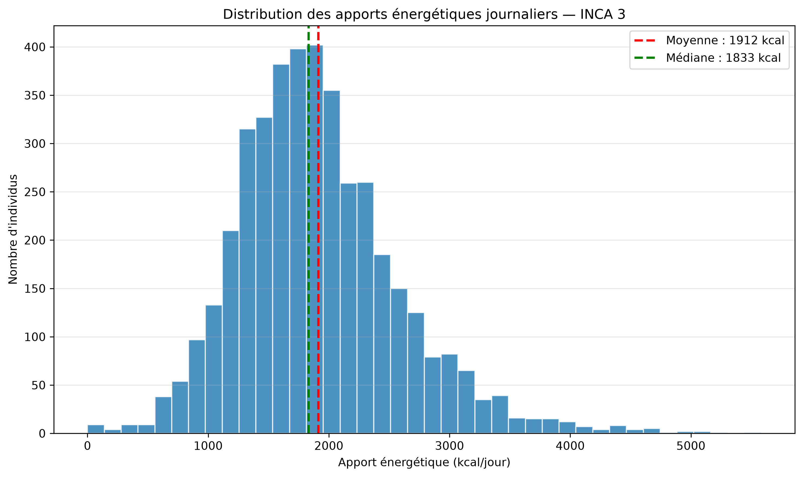
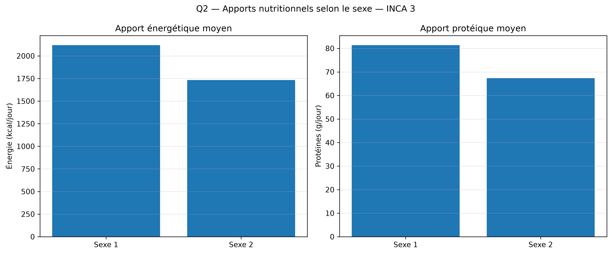
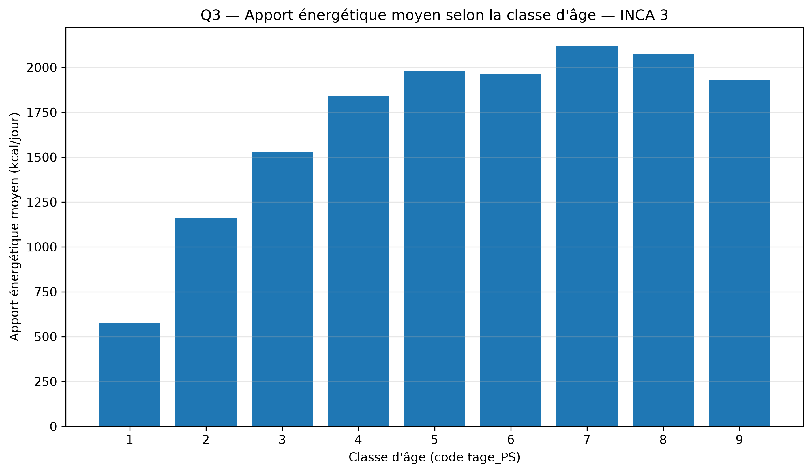
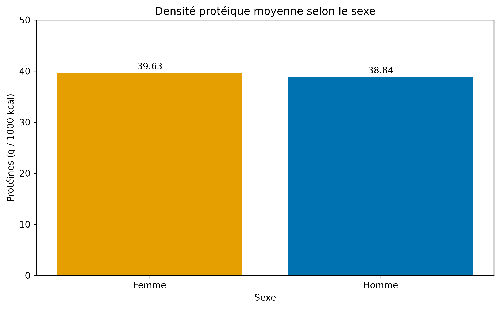
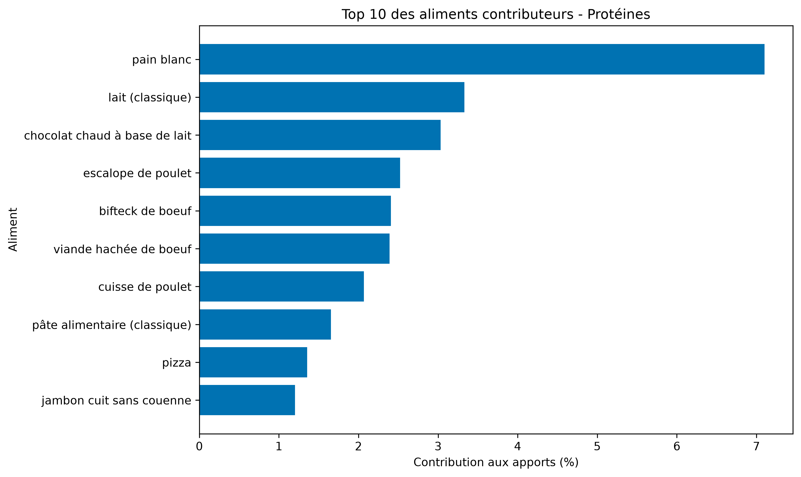
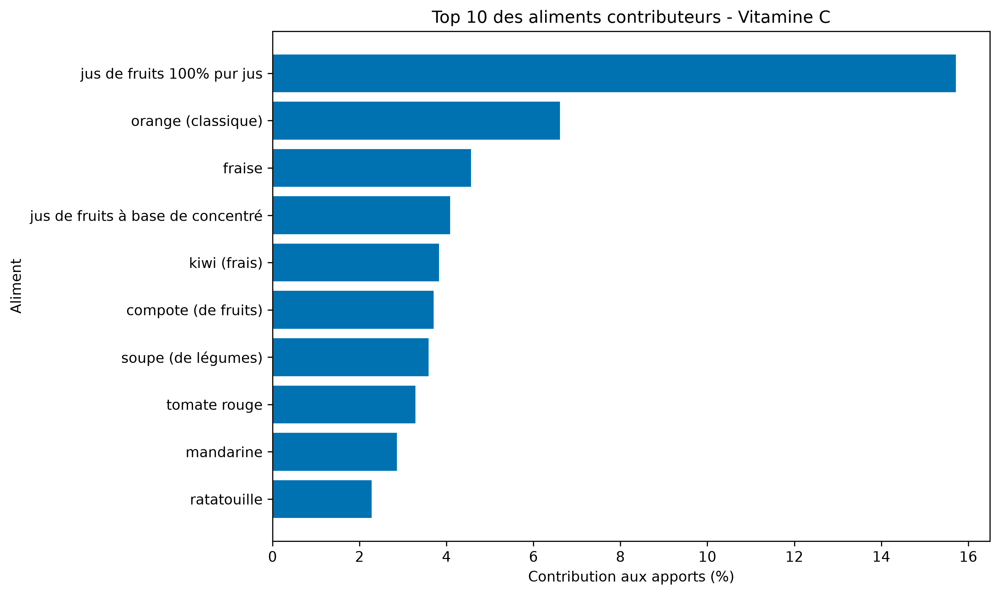
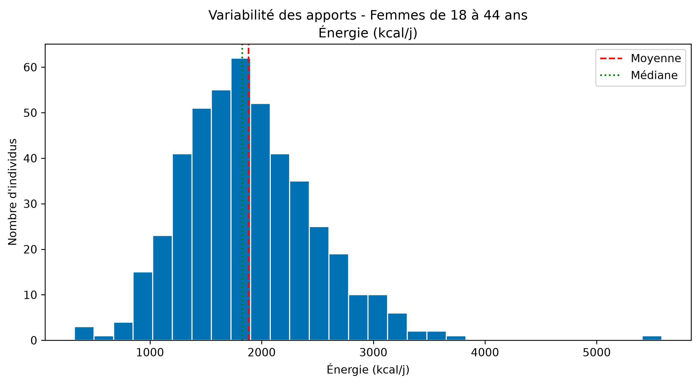
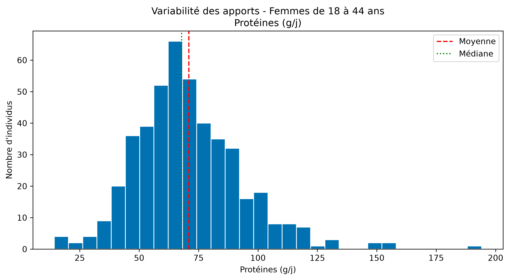

# NutriHFr — Analyse des consommations alimentaires et des apports nutritionnels à partir des données INCA 3

**Projet académique — Parcours IODAA, AgroParisTech**  
**Année universitaire : 2026–2027**  
**Auteur : Lucca Faccin dos Santos**

## Résumé

Le projet NutriHFr vise à explorer les consommations alimentaires et les apports nutritionnels observés dans l'étude INCA 3, à partir de données individuelles et d'enregistrements alimentaires. Il combine la préparation de données, la construction d'une base relationnelle SQLite, la programmation orientée objet en Python, des analyses statistiques descriptives et une application interactive développée avec Streamlit.

Trois fichiers de données ont été exploités : les caractéristiques de 5 855 individus, les apports nutritionnels de 4 114 individus et 256 301 enregistrements de consommation alimentaire. Six analyses ont été réalisées, portant sur les apports énergétiques, les différences selon le sexe et l'âge, la densité protéique, les principaux aliments contributeurs et la variabilité nutritionnelle d'un sous-groupe.

Les résultats doivent être interprétés comme des analyses exploratoires des observations disponibles, et non comme des estimations représentatives de l'ensemble de la population française.

## 1. Introduction et objectifs

L'analyse des consommations alimentaires permet d'étudier la diversité des comportements nutritionnels et la variabilité des apports en énergie et en nutriments.

L'étude individuelle nationale des consommations alimentaires INCA 3, réalisée par l'Anses, constitue une source de données pour explorer ces questions. Elle met à disposition des informations individuelles, des apports nutritionnels et des enregistrements de consommation alimentaire.

L'objectif principal du projet NutriHFr est de construire une chaîne d'analyse reproductible permettant d'exploiter ces données à l'aide de Python et de SQL.

Les objectifs opérationnels sont les suivants :

- Explorer et contrôler la qualité des données disponibles.
- Organiser les informations dans une base relationnelle SQLite.
- Structurer une partie des traitements selon les principes de la programmation orientée objet.
- Répondre à six questions d'analyse nutritionnelle.
- Présenter les résultats dans un tableau de bord Streamlit.
- Vérifier les principales fonctionnalités à l'aide de tests automatisés.

## 2. Données et préparation

### 2.1. Sources

Trois fichiers CSV issus des données INCA 3 ont été utilisés.

| Fichier source | Table SQLite | Effectif |
|---|---|---:|
| `description-indiv.csv` | `individus` | 5 855 |
| `apports-nut-alim.csv` | `apports` | 4 114 |
| `conso-compo-alim-vf-mad-datagouv2021.csv` | `consommations` | 256 301 |

La table `individus` contient les caractéristiques individuelles, notamment le sexe et la classe d'âge. La table `apports` regroupe les apports nutritionnels individuels. La table `consommations` contient les enregistrements alimentaires et les variables de composition nutritionnelle.

Les données brutes sont conservées dans `data/raw/inca3/` et ne sont pas modifiées.

### 2.2. Exploration et contrôles de qualité

L'exploration initiale a été réalisée dans le notebook `notebooks/01_exploration_inca3.ipynb`.

Les vérifications ont notamment porté sur les dimensions des fichiers, les identifiants, les relations entre les tables, les variables sociodémographiques et les apports énergétiques nuls.

Les clés retenues sont :

- `NOIND`, identifiant individuel dans `individus` et `apports`.
- `NUM_LIGNE`, identifiant des enregistrements dans `consommations`.
- `NOIND`, clé de liaison entre les consommations et les individus.

Les contrôles d'intégrité référentielle de la base reconstruite n'ont révélé aucune violation.

Huit observations présentent un apport énergétique nul. Elles sont conservées dans les statistiques descriptives générales, mais exclues des calculs nécessitant une division par l'apport énergétique.

### 2.3. Construction de la base SQLite

Les données ont été intégrées dans une base relationnelle SQLite comprenant trois tables principales.

Le script `src/construction_base.py` permet de reconstruire la base à partir des fichiers CSV originaux. L'importation des consommations s'effectue par blocs afin de limiter l'utilisation de la mémoire.

Les tables finales conservent les colonnes importées et comportent des contraintes de clés primaires et étrangères. Un index facilite les jointures sur les identifiants individuels.

Une seconde base a été reconstruite afin de vérifier la reproductibilité de la procédure. Les effectifs et les moyennes contrôlées étaient identiques à ceux de la base initiale.

## 3. Méthodologie d'analyse

### 3.1. Outils informatiques

Les principaux outils utilisés sont Python, pandas, NumPy, SQLite, JupyterLab, matplotlib, Streamlit et pytest.

Le code comprend deux classes principales :

**`BaseDonnees`** : assure la connexion à SQLite, l'exécution des requêtes et l'extraction de statistiques.

**`AnalyseNutritionnelle`** : regroupe plusieurs méthodes d'analyse des apports énergétiques, protéiques et de la densité nutritionnelle.

Cette organisation permet de séparer une partie de l'accès aux données des opérations analytiques.

### 3.2. Indicateurs statistiques

Les analyses mobilisent notamment la moyenne, la médiane, l'écart-type, les quantiles et le coefficient de variation.

Le coefficient de variation est défini par :

\[
CV = \frac{\sigma}{\mu}\times 100
\]

où \(\sigma\) représente l'écart-type et \(\mu\) la moyenne.

La densité protéique est calculée selon :

\[
D_p = \frac{\text{Protéines (g/j)}}{\text{Énergie (kcal/j)}}\times 1000
\]

Elle est exprimée en grammes de protéines pour 1 000 kcal.

Pour les contributions alimentaires, l'apport estimé d'un enregistrement est calculé à partir de la quantité consommée pondérée et de la teneur nutritionnelle pour 100 g :

\[
A_{ij} = \frac{qte\_conso\_pond_{ij}\times T_{ij}}{100}
\]

La contribution relative de chaque aliment correspond ensuite à sa part dans la somme des apports estimés pour le nutriment étudié.

## 4. Résultats

### 4.1. Q1 — Distribution des apports énergétiques journaliers

L'analyse porte sur 4 114 observations d'apports nutritionnels.

| Indicateur | Résultat |
|---|---:|
| Effectif | 4 114 |
| Moyenne | 1 911,88 kcal/j |
| Médiane | 1 833,29 kcal/j |
| Écart-type | 672,88 kcal/j |
| Minimum | 0 kcal/j |
| Maximum | 5 582,39 kcal/j |

La moyenne est légèrement supérieure à la médiane, ce qui indique une distribution influencée par les valeurs élevées. Une variabilité importante est observée entre les individus.



*Figure 1 — Distribution des apports énergétiques journaliers.*

### 4.2. Q2 — Comparaison des apports selon le sexe

Les apports énergétiques et protéiques ont été comparés entre les groupes codés « Homme » et « Femme ».

| Indicateur | Hommes | Femmes |
|---|---:|---:|
| Effectif | 1 907 | 2 207 |
| Énergie moyenne (kcal/j) | 2 119,51 | 1 732,47 |
| Protéines moyennes (g/j) | 81,40 | 67,32 |

Dans les observations étudiées, les apports moyens en énergie et en protéines sont plus élevés chez les hommes que chez les femmes.

Cette comparaison est descriptive. Elle ne permet pas d'attribuer les différences observées au seul sexe, notamment en raison de la structure d'âge et d'autres caractéristiques des groupes.



*Figure 2 — Comparaison des apports énergétiques et protéiques selon le sexe.*

### 4.3. Q3 — Apports énergétiques selon les classes d'âge

L'étude des neuf classes d'âge permet d'explorer les différences d'apports énergétiques au cours de la vie.

| Classe d'âge | Effectif | Énergie moyenne (kcal/j) |
|---|---:|---:|
| 0–11 mois | 59 | 573,60 |
| 1–3 ans | 159 | 1 159,98 |
| 4–6 ans | 345 | 1 532,01 |
| 7–10 ans | 481 | 1 840,55 |
| 11–14 ans | 543 | 1 979,57 |
| 15–17 ans | 406 | 1 960,75 |
| 18–44 ans | 783 | 2 118,49 |
| 45–64 ans | 827 | 2 075,04 |
| 65–79 ans | 511 | 1 932,54 |

Les apports énergétiques moyens augmentent globalement entre les premières classes d'âge et l'âge adulte. La moyenne la plus élevée est observée dans le groupe des 18–44 ans.

Une diminution des moyennes apparaît ensuite dans les classes d'âge plus élevées.

Ces résultats doivent être interprétés avec prudence, car les échantillons enfants et adultes de l'étude INCA 3 sont constitués séparément.



*Figure 3 — Apports énergétiques moyens par classe d'âge.*

### 4.4. Q4 — Densité protéique pour 1 000 kcal

La densité protéique permet de comparer la quantité de protéines apportée relativement à l'énergie totale.

| Indicateur | Hommes | Femmes |
|---|---:|---:|
| Effectif valide | 1 901 | 2 205 |
| Moyenne (g/1 000 kcal) | 38,84 | 39,63 |
| Médiane (g/1 000 kcal) | 37,99 | 38,54 |
| Écart-type | 8,56 | 8,85 |

Malgré des apports protéiques absolus moyens plus élevés chez les hommes, la densité protéique moyenne est légèrement plus élevée chez les femmes.

Ce résultat illustre l'intérêt d'un indicateur rapporté à l'énergie totale : il permet une comparaison différente de celle fondée uniquement sur les quantités absolues.



*Figure 4 — Distribution de la densité protéique selon le sexe.*

### 4.5. Q5 — Principaux aliments contributeurs

Les contributions alimentaires ont été calculées à partir des enregistrements de consommation, des quantités pondérées `qte_conso_pond` et des teneurs nutritionnelles pour 100 g.

Pour chaque nutriment, les apports estimés ont été agrégés par code et libellé d'aliment.

| Nutriment | Principal aliment contributeur | Contribution estimée |
|---|---|---:|
| Protéines | Pain blanc | 7,10 % |
| Calcium | Lait (classique) | 9,63 % |
| Fer | Pain blanc | 8,39 % |
| Fibres | Pain blanc | 10,77 % |
| Vitamine C | Jus de fruits 100 % pur jus | 15,71 % |

Le pain blanc apparaît parmi les principaux contributeurs de plusieurs nutriments. Ce résultat reflète à la fois les teneurs nutritionnelles des aliments et les quantités consommées dans les enregistrements étudiés.

Les contributions présentées correspondent à la part de chaque aliment dans les apports estimés à partir des données disponibles. Elles ne représentent pas directement des contributions nationales pondérées par le plan de sondage complet.



*Figure 5 — Dix principaux aliments contributeurs aux apports protéiques.*



*Figure 6 — Dix principaux aliments contributeurs aux apports en vitamine C.*

Les graphiques complémentaires concernant le calcium, le fer et les fibres sont également disponibles dans `reports/figures/`.

### 4.6. Q6 — Variabilité des apports chez les femmes de 18 à 44 ans

L'analyse porte sur les individus de sexe féminin appartenant à la classe d'âge 18–44 ans, soit 459 observations.

| Indicateur | Énergie (kcal/j) | Protéines (g/j) |
|---|---:|---:|
| Effectif | 459 | 459 |
| Moyenne | 1 881,47 | 70,90 |
| Médiane | 1 826,95 | 67,89 |
| Écart-type | 597,74 | 22,48 |
| 10e percentile | 1 208,38 | 45,52 |
| 90e percentile | 2 683,68 | 98,77 |
| Coefficient de variation | 31,77 % | 31,71 % |

Les coefficients de variation des apports énergétiques et protéiques sont proches de 32 %, indiquant une dispersion relative comparable pour les deux indicateurs.

L'écart entre les 10e et 90e percentiles met également en évidence une variabilité importante au sein du sous-groupe.



*Figure 7 — Variabilité des apports énergétiques chez les femmes de 18 à 44 ans.*



*Figure 8 — Variabilité des apports protéiques chez les femmes de 18 à 44 ans.*

## 5. Tableau de bord et validation informatique

### 5.1. Application Streamlit

Une version publique du tableau de bord a également été déployée sur Streamlit Community Cloud :

**https://nutrihfr.streamlit.app/**

Cette version utilise des statistiques agrégées exportées dans `data/public/`, tandis que la version locale exploite directement la base SQLite. Les deux versions permettent de consulter les six analyses nutritionnelles.

Un tableau de bord interactif a été développé avec Streamlit dans le fichier `app.py`.

L'application présente une page d'accueil et six pages correspondant aux analyses Q1 à Q6. Elle permet de consulter les statistiques, les graphiques et, selon les analyses, de sélectionner des variables ou des nutriments.

La base SQLite sert de source aux requêtes exécutées par l'application.

Le tableau de bord peut être lancé localement avec :

```bash
python -m streamlit run app.py
```

### 5.2. Tests automatisés

Le projet utilise `pytest` pour vérifier plusieurs fonctionnalités liées à l'accès aux données et aux analyses nutritionnelles.

La commande :

```bash
python -m pytest -q
```

a permis de valider les neuf tests existants.

La syntaxe de l'application et du script de reconstruction a également été contrôlée à l'aide de `py_compile`.

Ces contrôles constituent une première validation technique, sans couvrir exhaustivement toutes les opérations de l'application.

### 5.3. Reproductibilité

Les fichiers sources sont conservés séparément de la base produite.

Le script `src/construction_base.py` permet de reconstruire la base SQLite à partir des CSV originaux, avec vérification des effectifs et de l'intégrité référentielle.

La base de données et les CSV bruts ne sont pas stockés dans le dépôt GitHub. Leur récupération est nécessaire pour reproduire intégralement les analyses.

Les instructions d'installation et d'exécution figurent dans le `README.md`.

## 6. Discussion et limites méthodologiques

Plusieurs précautions doivent être prises dans l'interprétation des résultats.

**Premièrement**, les analyses Q1 à Q4 et Q6 reposent principalement sur des statistiques descriptives non pondérées. Les poids individuels et le plan de sondage complexe ne sont pas intégrés systématiquement. Les résultats décrivent donc les observations disponibles plutôt que la population française dans son ensemble.

**Deuxièmement**, les échantillons enfants et adultes d'INCA 3 ont été constitués séparément. Les comparaisons entre toutes les classes d'âge ne doivent pas être assimilées à une estimation nationale unique.

**Troisièmement**, l'analyse Q5 utilise les quantités consommées pondérées `qte_conso_pond`. Cette variable intègre `R24_pond`, qui tient compte du type de jour de rappel alimentaire. Elle ne remplace cependant pas les pondérations individuelles nécessaires à une estimation représentative de la population.

**Quatrièmement**, les valeurs nulles ou manquantes peuvent réduire les effectifs de certaines analyses. En particulier, les huit observations d'énergie nulle sont exclues des calculs de densité protéique.

Enfin, les différences observées entre groupes sont descriptives. Aucune interprétation causale ni conclusion clinique ne peut être déduite directement de ces comparaisons.

## 7. Conclusion et perspectives

Le projet NutriHFr a permis de développer une chaîne d'analyse de données nutritionnelles, depuis l'exploration des fichiers INCA 3 jusqu'à la visualisation interactive des résultats.

Les six analyses réalisées mettent en évidence la dispersion des apports énergétiques, des différences descriptives selon le sexe et l'âge, l'intérêt des indicateurs de densité nutritionnelle, les contributions de différents aliments et la variabilité au sein d'un sous-groupe.

Sur le plan informatique, le projet mobilise Python, SQLite, SQL, la programmation orientée objet, JupyterLab, Streamlit, les tests automatisés et Git.

Les principales améliorations envisageables sont l'intégration complète des pondérations individuelles, une prise en compte du plan de sondage, une analyse plus approfondie des valeurs manquantes et l'extension de la couverture des tests.

## Références

1. Anses. *Étude individuelle nationale des consommations alimentaires 3 (INCA 3)*.
2. Anses. *Notice d'utilisation des données INCA 3*, version diffusée sur data.gouv.fr.
3. Anses. Documentation de la nomenclature et des variables INCA 3.
4. Documentation officielle de Python, pandas, SQLite, Streamlit et pytest.
